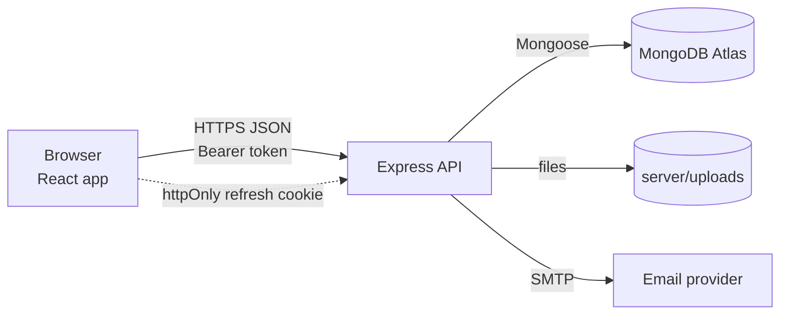
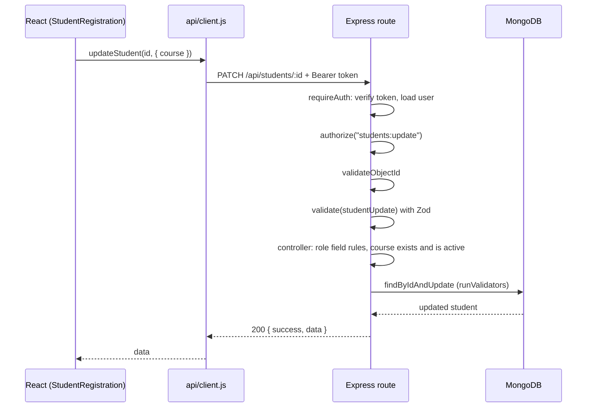

# Architecture

## Overview

The app has three parts:

| Part | Responsibility |
|---|---|
| **React client** (`client/`) | Pages, forms, client-side validation, hiding actions a role cannot use |
| **Express API** (`server/`) | Authentication, permissions, validation, business rules, file and email handling |
| **MongoDB** | Users, students, courses, instructors, document records |

The client never talks to the database directly and holds no secrets.

## How a request flows

Example: staff updates a student's course.

If the access token has expired, `api/client.js` calls `/api/auth/refresh` once (using the httpOnly cookie) and retries the request. If that fails, the user is logged out.

Every response uses the same shape: `{ success, data }` or `{ success: false, message, errors }`.

## Server layers

| Layer | Folder | Job |
|---|---|---|
| Routes | `routes/` | Map URLs to handlers and attach middleware in a fixed order |
| Middleware | `middleware/` | `requireAuth` → `authorize` → `validateObjectId` → `validate` (Zod) → upload limits |
| Controllers | `controllers/` | Business rules and database calls |
| Models | `models/` | Mongoose schemas, validation, indexes |
| Services | `services/` | File storage and email, kept separate so they can be swapped (for example S3) |
| Config | `config/` | Permissions, upload rules, database connection |
| Error handler | `middleware/errorHandler.js` | Converts every error to a consistent JSON response; no stack traces to users |

## Client structure

| Folder | Job |
|---|---|
| `api/` | One function per endpoint; `client.js` adds the token, refreshes it, handles files |
| `context/AuthContext.jsx` | Current user, login and logout, `can()`, `canSeeField()`, `canEditField()` |
| `components/ProtectedRoute.jsx` | Sends logged-out users to login, shows Access denied for missing permissions |
| `pages/` | One component per page |
| `utils/` | Validation rules, permissions map, formatting, upload rules |

## Authentication

| Item | Design |
|---|---|
| Access token | JWT, 15 minutes, kept in memory (not localStorage), sent as `Authorization: Bearer` |
| Refresh token | JWT, 7 days, in an httpOnly, sameSite=strict cookie limited to `/api/auth` |
| Passwords | bcrypt, cost 12 |
| Logout and password changes | Increase the user's `tokenVersion`, so every existing token stops working |
| Password reset | Random token; only its SHA-256 hash is stored; expires in 15 minutes; single use |
| CSRF | Writes require the Bearer header, which browsers never send automatically |

## Authorization

- `server/config/permissions.js` is the single source of truth (for example `students:delete: ["admin"]`).
- `authorize(permission)` returns 403 when the role lacks it.
- The user's role is read from the database on every request, not trusted from the token.
- Field-level rules: viewers never receive mobile and address; staff cannot change email.
- `client/src/utils/permissions.js` mirrors the rules only to hide buttons and links.

## Key decisions

| Decision | Reason |
|---|---|
| Students reference courses by ID | Renaming a course updates every student; relationships can be validated |
| Course delete blocked when students exist | Prevents students pointing to a missing course; set it inactive instead |
| One `$facet` aggregation for the dashboard | All figures from the same filtered data in one query |
| Files checked by their first bytes, saved under random names, served through the API | A renamed or malicious file cannot be stored or run |
| Email sent after saving, in the background | A failed email never loses an enrollment |
| Zod with `.strict()` | Unexpected fields such as `role` are rejected, not silently ignored |
| Dashboard page loaded on demand | Keeps the chart library out of the first page load |
| Tests use an in-memory MongoDB | Fast, isolated, and never touch real data |