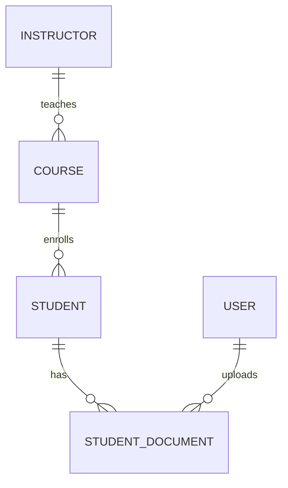

# Database schema

MongoDB with Mongoose. All collections have automatic `createdAt` and `updatedAt`.

## Relationships

## users
| Field | Type | Rules |
|---|---|---|
| username | String | Required, unique, 3–30 characters, letters, numbers and underscores, lowercase |
| email | String | Required, unique, valid format, lowercase |
| password | String | Required, bcrypt hash, never returned (`select: false`) |
| role | String | `admin`, `staff` or `viewer`; default `viewer` |
| tokenVersion | Number | Increased on logout, password change and role change; hidden |
| passwordResetTokenHash | String | SHA-256 of the reset token; hidden |
| passwordResetExpires | Date | Reset link expiry; hidden |

## students
| Field | Type | Rules |
|---|---|---|
| fullName | String | Required, at least 3 characters |
| email | String | Required, unique, valid format, lowercase |
| mobile | String | Required, 10 digits starting with 6–9 |
| gender | String | `male`, `female` or `other` |
| course | ObjectId → courses | Required; must exist and be active when assigned |
| address | String | Required, at least 10 characters |
| enrollmentStatus | String | `active`, `completed`, `withdrawn` or `suspended`; default `active` |
| photo | Object or null | `{ key, mimeType, size, originalName, uploadedAt }`; the storage key is never returned |
| enrollmentEmail | Object | `{ status, attempts, sentAt, messageId, lastError }`; status is `pending`, `sending`, `sent` or `failed` |

## courses
| Field | Type | Rules |
|---|---|---|
| name | String | Required, 2–100 characters |
| code | String | Required, unique, 2–12 letters, numbers or hyphens, uppercase |
| description | String | Up to 1000 characters |
| durationMonths | Number | Whole number, 1–120 |
| fee | Number | 0 or more |
| status | String | `active` or `inactive`; default `active` |
| instructor | ObjectId → instructors | Optional; must exist |

## instructors
| Field | Type | Rules |
|---|---|---|
| fullName | String | Required, 3–100 characters |
| email | String | Required, unique, valid format |
| specialization | String | Required, up to 100 characters |

## studentdocuments
| Field | Type | Rules |
|---|---|---|
| student | ObjectId → students | Required |
| key | String | Storage path (random UUID); never returned |
| originalName | String | Cleaned file name, up to 100 characters |
| mimeType | String | Detected from the file's content |
| size | Number | Bytes |
| uploadedBy | ObjectId → users | Who uploaded it |

## Indexes
| Collection | Index | Purpose |
|---|---|---|
| users | username (unique), email (unique) | Login and duplicate prevention |
| students | email (unique) | Duplicate prevention |
| students | createdAt, fullName | Sorting |
| students | course, enrollmentStatus | Filters and dashboard grouping |
| courses | code (unique), name, status, instructor | Duplicates, sorting, filters, instructor lookups |
| instructors | email (unique), fullName | Duplicates, sorting |
| studentdocuments | student + createdAt | Listing a student's documents |

## Delete behaviour
| Deleting | Result |
|---|---|
| A course with students | Blocked with 409; set it to inactive instead |
| A course without students | Deleted |
| An instructor | Deleted; their courses become unassigned |
| A student | Deleted, along with their photo, documents and document records |
| A user | Admin only; admins cannot delete themselves, and the last admin cannot be removed |